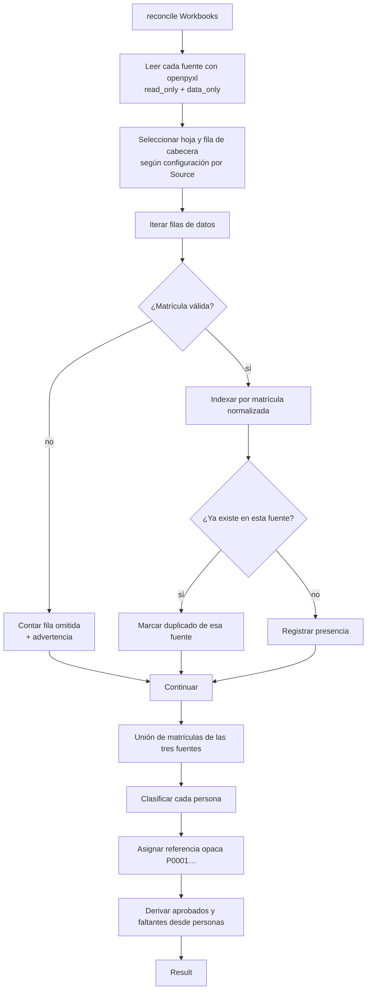
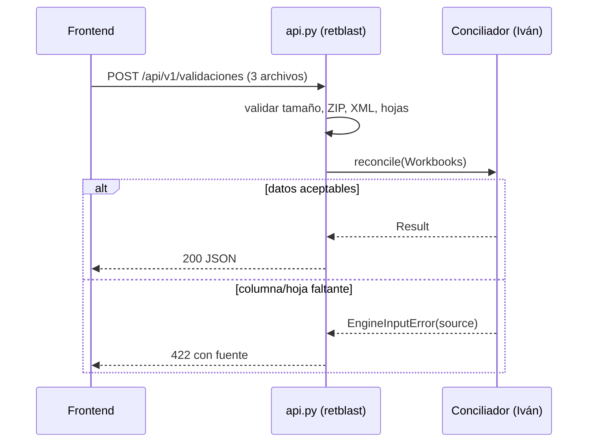
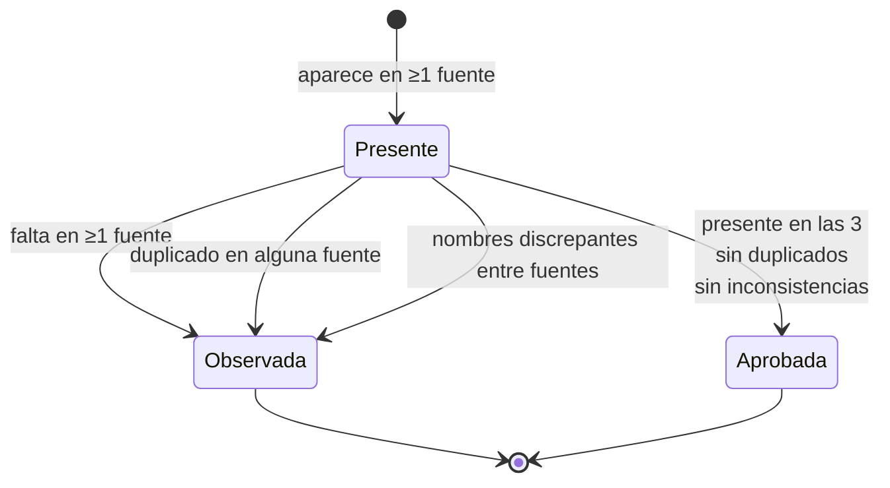
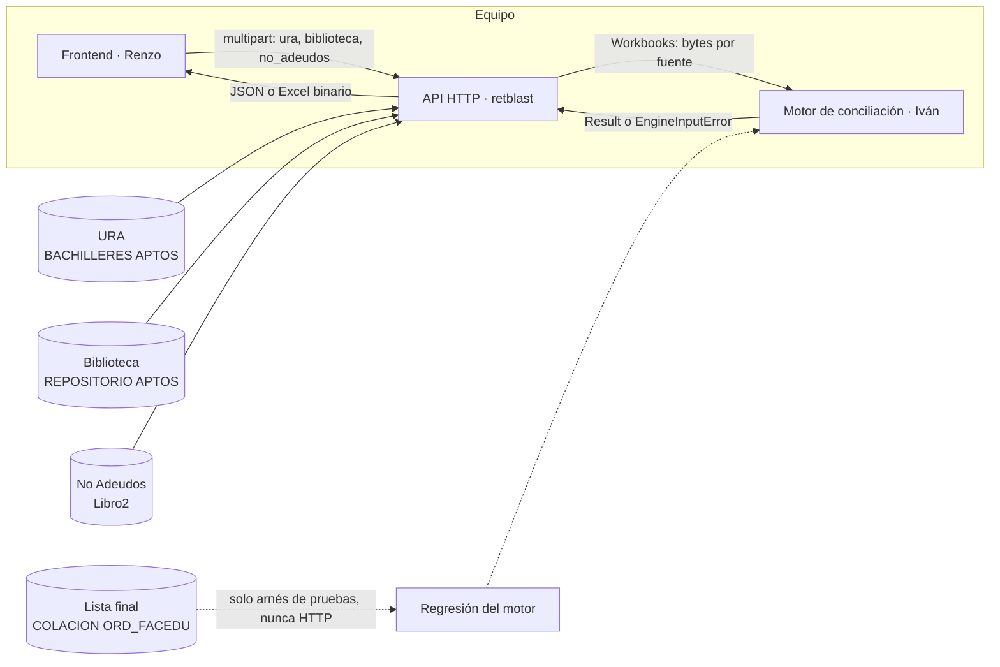

# Motor de conciliación — diseño detallado (Semana 13)

**Fecha:** 2026-11-25  
**Responsable:** Iván Sánchez Silva — integrante 3, motor de procesamiento  
**Rama:** `feat/motor-conciliacion-inicial`  
**Estado:** **diseño ratificado e implementación verificada** con datos sintéticos y conteos agregados reales; PR #3 abierto para revisión  
**Base:** PR #1 (`Inicializar el backend y el contrato de ConciliaFECC`) mergeado en `main`  
**PR de este trabajo:** https://github.com/retblast/conciliafecc/pull/3

> Este documento **planifica, decide y registra la verificación**. La
> implementación quedó concentrada en `conciliafecc/motor.py` y sus pruebas;
> este texto distingue tres planos que no deben mezclarse:
> 1. **Diseño** (este documento).
> 2. **Verificación con datos sintéticos** (cuando se implemente).
> 3. **Integración real** (solo cuando el usuario autorice el cableado y las
>    áreas confirmen los supuestos pendientes).
>
> Los archivos institucionales se inspeccionaron solo de forma estructural.
> **No se copiaron al repositorio, no se volcaron filas ni datos personales a
> logs y no se versiona ningún resultado con identificadores reales.** Aquí solo
> aparecen nombres de archivo, hojas, cabeceras y conteos agregados.

---

## 1. Resumen ejecutivo

La interfaz acordada en el PR #1 sirve sin cambios:

```python
Engine.reconcile(workbooks: Workbooks) -> Result
```

La API entrega tres bloques de bytes ya separados por dependencia y el motor
devuelve un `Result` del contrato compartido. El motor **no conoce HTTP**, no
guarda archivos y no decide la descarga.

Con los cuatro Excel reales encontrados en `C:\Users\Alfredo\Downloads` se
ratificaron seis decisiones:

| # | Decisión | Resultado |
|---|---|---|
| D1 | Mapa de fuentes | `BACHILLERES...` → URA; `REPOSITORIO...` → Biblioteca; `Libro2.xlsx` → No Adeudos |
| D2 | Clave de persona | Matrícula normalizada, con DNI solo como referencia secundaria cuando exista |
| D3 | Aprobación del MVP | Presencia confirmada en las tres fuentes, sin duplicados ni inconsistencias |
| D4 | Lista final | Verdad de prueba, **no** cuarta entrada HTTP |
| D5 | Hojas de entrada | `Worksheet` en los dos de 63 e `Hoja1` en `Libro2`; se ignoran `TITULACION SEP 2026...` |
| D6 | Descarga | POST binario que reenvía los tres archivos; el exportador sigue siendo de retblast |

**Aclaración obligatoria sobre D3:** las listas de entrada no traen una columna
de estado. La regla «aparecer en las tres = aprobado» se activa porque el
encargado la ratificó para el MVP y porque los propios nombres de archivo dicen
`APTOS`, pero queda escrita como **supuesto pendiente de confirmación
institucional**. No es un requisito inventado ni una validación ya aceptada por
las dependencias.

---

## 2. Contexto y estado de partida

| Elemento | Estado observado |
|---|---|
| `docs/CONTRATO_API.md` | Contrato preliminar, `Workbooks` / `Result` / `Engine` ya definidos |
| `conciliafecc/contracts.py` | DTOs Pydantic, `Source`, validadores de coherencia de totales |
| `conciliafecc/api.py` | `GET /health`, `POST /api/v1/validaciones`; responde 503 sin motor |
| `conciliafecc/uploads.py` | Valida ZIP/XLSX, límites, XML defensivo; **no** valida columnas de negocio |
| `conciliafecc/export.py` | Exportador interno provisional, sin endpoint |
| Suite previa | 22 pruebas sintéticas en verde |
| Motor en `main` | No existe implementación conectada |
| Motor en esta rama | `conciliador` implementado según este diseño; aún no inyectado en la API |

Fuera de alcance de este componente: `api.py`, `contracts.py`, `uploads.py`,
`export.py`, OpenAPI, frontend y README. Cualquier cambio en esos archivos se
coordinará con retblast o Renzo antes de tocarlos.

---

## 3. Evidencia estructural de los Excel reales

### 3.1 Archivos de entrada

| Archivo real | Hoja usada | Cabecera | Columna clave | Registros con clave válida | Duplicados internos |
|---|---|---:|---:|---:|---:|
| `BACHILLERES O LICENCIADOS APTOS COLACION 18-SETIEMBRE 2026 (1).xlsx` | `Worksheet` | fila 2 | `N° Matrícula` (col. 4) | 63 | 0 |
| `REPOSITORIO_BACH_LICENC_APTOS COLACION 18-SET_2026 -11AGTO.xlsx` | `Worksheet` | fila 2 | `N° Matrícula` (col. 4) | 63 | 0 |
| `Libro2.xlsx` | `Hoja1` | sin cabecera | col. 3 (mismo patrón de 5 columnas) | 47 | 0 |

Las otras hojas de los dos primeros archivos (`TITULACION SEP 2026...`) tienen
13 columnas, fórmulas y cabeceras no detectables en las primeras diez filas.
Se excluyen del MVP (D5) para no mezclar datos originales con valores
calculados ni inventar una cabecera.

### 3.2 Lista final como verdad de prueba

| Hoja | Cabecera | Matrículas | Observaciones |
|---|---:|---:|---|
| `TIT_FORMAT_NUEVO 18-SET-2026` | fila 5 | 66 | Columnas `NO ADEUDO` y `REPOSITORIO` en las posiciones 12 y 13, ocultas |
| `BACH_FORMAT_NUEVO 18-SET-2026` | fila 7 | 29 | Sin columnas de estado |
| `BACH_TIT_NO ENTREGADOS_COLAC` | fila 7 | 7 | Sin columnas de estado |
| **Unión** | — | **95** | 64 con `NO ADEUDO`, 63 con `REPOSITORIO = SI`, 63 con ambas marcas |

La final **no entra a la API**. Se usa únicamente para derivar reglas y medir
regresión (D4).

### 3.3 Solapamientos agregados

| Conjunto | Tamaño | En la unión de la final |
|---|---:|---:|
| URA (`BACHILLERES...`) | 63 | 53 |
| Biblioteca (`REPOSITORIO...`) | 63 | 53 |
| No Adeudos (`Libro2`) | 47 | 42 |
| Unión de las tres entradas | 79 | 66 |
| Intersección de las tres | **31** | 31 |

Dos consecuencias de diseño:

1. URA y Biblioteca tienen **63/63 matrículas idénticas**. No son detectables
   como fuentes distintas por su contenido; se distinguen solo por el campo
   `Workbooks` que las transporta. El mapeo D1 es una decisión de negocio
   ratificada, no una inferencia automática del motor.
2. La final contiene 95 matrículas, pero solo 66 están en la unión de las tres
   entradas. Exigir igualdad exacta entre el resultado del motor y la final
   produciría diferencias que no son errores del motor. Por eso D4 se implementa
   con cobertura y precisión, no con comparación estricta.

---

## 4. Decisiones ratificadas y preguntas respondidas

Las preguntas se hicieron en dos rondas, con opciones y recomendación
explícita. Esta tabla es el registro vivo de lo que se decidió y por qué.

| Ronda | Pregunta | Respuesta del encargado | Consecuencia en el diseño |
|---|---|---|---|
| 1 | Mapa de fuentes | Delegado → se ratificó la recomendación | D1: `BACHILLERES`=URA, `REPOSITORIO`=Biblioteca, `Libro2`=No Adeudos |
| 1 | Clave de persona | Matrícula normalizada | D2: clave interna; DNI nunca es clave de comparación |
| 1 | Papel de la final | Verdad de prueba | D4: fuera del contrato HTTP; entra solo al arnés de regresión |
| 2 | Ratificación del mapa | Ratificar mapeo | D1 queda cerrado para el MVP |
| 2 | Regla de aprobación | Ratificar presencia en 3 | D3 activo, con aviso de supuesto en `advertencias` |
| 2 | Hojas de entrada | Hojas limpias | D5: `Worksheet` / `Hoja1` |
| 2 | Duplicados | Marcar y no aprobar | El contrato conserva `duplicados` y bloquea la aprobación |
| 2 | Comparación con la final | Cobertura y precisión | §12.2: métricas, no igualdad estricta |
| 2 | Descarga | POST binario con tres archivos | D6: dependencia de retblast; el motor solo entrega `Result` |
| Técnica | `referencia` | Fijada por el contrato | Opaca `P0001…`; la matrícula nunca se devuelve |
| Técnica | Normalización de matrícula | Sin colisiones observadas | Solo dígitos, se preservan ceros a la izquierda; sin relleno artificial |

### 4.1 Por qué la recomendación de mapeo es la mejor disponible

- El nombre `REPOSITORIO_BACH_LICENC_APTOS...` coincide con la columna
  `REPOSITORIO` de la hoja principal de la final. En una facultad, el
  repositorio de trabajos suele estar bajo la órbita de Biblioteca; no hay una
  dependencia «Repositorio» en el encargo.
- `BACHILLERES O LICENCIADOS APTOS...` describe exactamente la función de
  registro académico: declarar quién puede colacionar.
- `Libro2.xlsx` no tiene nombre institutable, pero es el único archivo
  restante; asignarlo a No Adeudos es la única opción que completa las tres
  fuentes sin inventar una cuarta.
- Invertir URA y Biblioteca no cambiaría los conteos (sus matrículas son
  idénticas), pero sí dejaría sin explicación la columna `REPOSITORIO` de la
  final. Por eso se descarta.

---

## 5. Arquitectura

### 5.1 Diagrama de contexto

```mermaid
flowchart LR
    subgraph Equipo
        F[Frontend · Renzo]
        A[API HTTP · retblast]
        M[Motor de conciliación · Iván]
    end

    F -->|multipart: ura, biblioteca, no_adeudos| A
    A -->|Workbooks: bytes por fuente| M
    M -->|Result o EngineInputError| A
    A -->|JSON o Excel binario| F

    URA[(URA<br/>BACHILLERES APTOS)] --> A
    BIB[(Biblioteca<br/>REPOSITORIO APTOS)] --> A
    NA[(No Adeudos<br/>Libro2)] --> A

    FINAL[(Lista final<br/>COLACION ORD_FACEDU)]
    FINAL -.->|solo arnés de pruebas, nunca HTTP| TEST[Regresión del motor]
    TEST -.-> M
```



La línea punteada es importante: la lista final alimenta **pruebas**, no la
ejecución del servicio. El motor no tiene parámetro `final`.

### 5.2 Flujo interno del motor



### 5.3 Secuencia con la API



El motor lanza `EngineInputError(source)` **solo** cuando no puede leer la
estructura configurada de una fuente. Una fila suelta con matrícula inválida no
rompe la petición: se omite y se advierte.

### 5.4 Clasificación de una persona



**Regla de oro:** cualquier entrada en `faltantes`, `duplicados` o
`inconsistencias` impide `aprobada=true`. El validador de `PersonResult` ya lo
exige en el contrato; el motor lo cumple por construcción.

---

## 6. Modelo de datos interno

El motor usa estructuras propias y solo al final las traduce a los DTOs del
contrato. Ninguna estructura interna se serializa.

| Estructura | Campos | Uso |
|---|---|---|
| `FuenteConfig` | `hoja`, `fila_cabecera`, `columna_clave`, `columna_nombre`, `fila_inicio` | Cómo leer cada `Source` |
| `LecturaFuente` | `registros`, `por_clave`, `sin_clave`, `invalidas`, `duplicados`, `nombres` | Estado agregado de una fuente |
| `RegistroInterno` | `fila`, `clave`, `nombre_normalizado` | Una fila válida; `clave` nunca se publica |
| `PersonaInterna` | `clave`, `referencia`, `fuentes`, `duplicados`, `inconsistencias` | Unión de las tres lecturas |

Mapeo a la salida:

| Interno | Contrato |
|---|---|
| `len(lectura.registros)` por fuente | `registros_por_fuente` |
| `PersonaInterna.aprobada` | `PersonResult.aprobada` |
| `PersonaInterna.fuentes` ausentes | `PersonResult.faltantes` |
| `PersonaInterna.duplicados` | `PersonResult.duplicados` |
| `PersonaInterna.inconsistencias` | `PersonResult.inconsistencias` |
| `referencia` secuencial | `PersonResult.referencia` |
| conteos derivados | `aprobados`, `faltantes_por_fuente` |

---

## 7. Configuración de lectura

El motor **no necesita saber los nombres de archivo**: `Workbooks` ya trae los
bytes bajo `ura`, `biblioteca` y `no_adeudos`. Los nombres reales se documentan
para quien arma la petición (frontend/API), no para el código del motor.

| `Source` | Archivo que debe enviarse en esa parte | Hoja | Fila de cabecera | Columna clave | Columna nombre | Observaciones |
|---|---|---|---:|---:|---:|---|
| `URA` | `BACHILLERES O LICENCIADOS APTOS COLACION 18-SETIEMBRE 2026 (1).xlsx` | `Worksheet` | 2 | 4 (`N° Matrícula`) | 2 y 3 (`Apellidos`, `Nombres`) | Ignora col. 1 (numerador) y hojas `TITULACION...` |
| `LIBRARY` | `REPOSITORIO_BACH_LICENC_APTOS COLACION 18-SET_2026 -11AGTO.xlsx` | `Worksheet` | 2 | 4 (`N° Matrícula`) | 2 y 3 | Misma estructura; no comparar por contenido |
| `CLEARANCE` | `Libro2.xlsx` | `Hoja1` | ninguna; inicio en fila 1 | 3 | 1 y 2 | Sin cabecera; patrón de 5 columnas |

Si la hoja configurada no existe o la cabecera esperada no aparece en la fila
indicada, se lanza `EngineInputError(source)`. Para `CLEARANCE`, donde no hay
cabecera, se valida que la columna 3 tenga una proporción razonable de
matrículas válidas; si no, también se rechaza la fuente.

### 7.1 Normalización de la matrícula

```
1. NFKC sobre el valor textual.
2. Quitar espacios de borde y colapsar espacios internos.
3. Si el valor es numérico entero, convertir con str(int(valor)).
4. Aceptar solo /^\d{8,}$/; lo demás se cuenta como inválido.
5. Conservar ceros a la izquierda. No rellenar, no recortar.
```

Justificación:

- En los archivos reales hay 61 celdas numéricas y 2 textuales por archivo de
  63; las 2 textuales tienen ceros a la izquierda y aparecen **idénticas** en
  URA y Biblioteca. Recortar esos ceros no aumenta la coincidencia observada y
  podría fusionar personas distintas en otros lotes.
- Excel ya pierde los ceros iniciales cuando guarda una matrícula como número;
  el motor no puede recuperarlos sin inventar información.
- No se usan apellidos ni nombres para decidir coincidencias. El nombre solo se
  normaliza para detectar discrepancias y se reporta como inconsistencia.

---

## 8. Algoritmo de conciliación

```python
def reconcile(workbooks):
    lecturas = {fuente: leer(getattr(workbooks, fuente.value), CONFIG[fuente])
                for fuente in Source}

    claves = sorted(set().union(*(lectura.por_clave for lectura in lecturas.values())))
    referencias = {clave: f"P{i:04d}" for i, clave in enumerate(claves, 1)}

    personas = []
    for clave in claves:
        faltantes = [f for f in Source if clave not in lecturas[f].por_clave]
        duplicados = [f for f in Source if clave in lecturas[f].duplicados]
        inconsistencias = []

        for fuente in duplicados:
            inconsistencias.append(f"Registro duplicado en {fuente.value}.")

        nombres = {
            normalizar_texto(lecturas[f].por_clave[clave].nombre)
            for f in Source if clave in lecturas[f].por_clave
        }
        if len(nombres) > 1:
            inconsistencias.append("Los nombres no coinciden entre las fuentes.")

        aprobada = not faltantes and not duplicados and not inconsistencias
        personas.append(PersonResult(
            referencia=referencias[clave],
            aprobada=aprobada,
            faltantes=faltantes,
            duplicados=duplicados,
            inconsistencias=inconsistencias,
        ))

    return Result(
        registros_por_fuente=SourceCounts(**{
            f.value: lecturas[f].registros for f in Source
        }),
        aprobados=sum(p.aprobada for p in personas),
        faltantes_por_fuente=SourceCounts(**{
            f.value: sum(f in p.faltantes for p in personas) for f in Source
        }),
        personas=personas,
        advertencias=construir_advertencias(lecturas),
    )
```

### 8.1 Complejidad

- Lectura: `O(N)` sobre las filas de las tres hojas.
- Indexación: `O(1)` por fila con un dict por fuente.
- Unión y clasificación: `O(U · 3)`, donde `U` es el número de matrículas
  únicas (79 con estos archivos).
- Orden de `personas`: por matrícula normalizada, solo para estabilidad de
  referencias. La matrícula ordenada nunca se publica.
- Memoria: `O(U · 3)`; los libros se abren en modo solo lectura y se cierran en
  `finally`.

---

## 9. Reglas de negocio

| ID | Regla | Acción |
|---|---|---|
| RN-01 | La clave es la matrícula normalizada | Comparar solo esa clave entre fuentes |
| RN-02 | Matrícula inválida (`<8` dígitos o con letras) | Omitir fila, contarla y avisar |
| RN-03 | Matrícula repetida dentro de una fuente | Registrar duplicado, contar como registro, bloquear aprobación |
| RN-04 | Matrícula ausente en una fuente | Agregar esa fuente a `faltantes` |
| RN-05 | Nombres distintos para la misma matrícula | Agregar inconsistencia; **no** usar nombres para aprobar |
| RN-06 | Presente en las tres, sin duplicados y sin inconsistencias | `aprobada=true` (D3, con supuesto documentado) |
| RN-07 | Totales | Derivar `aprobados` y `faltantes_por_fuente` desde `personas` |
| RN-08 | Referencias | `P0001…P####`, opacas, estables dentro de una ejecución |
| RN-09 | Supuesto de aprobación | Advertencia fija en `advertencias` recordando que D3 está pendiente de confirmación de áreas |
| RN-10 | Coincidencia aproximada | Prohibida; `123456789` y `123456788` son personas distintas |

### 9.1 Advertencias esperadas

- `«Regla de aprobación ratificada para el MVP: presencia en las tres fuentes sin discrepancias. Pendiente de confirmación institucional.»` — siempre.
- `«ura/biblioteca/no_adeudos: se omitieron N fila(s) sin matrícula válida.»` — solo si aplica.
- `«N matrícula(s) presentan nombres discrepantes entre fuentes.»` — solo si aplica.
- No se incluyen nombres, matrículas ni rutas de archivo en las advertencias.

---

## 10. Errores y límites

| Situación | Comportamiento del motor | Efecto en API |
|---|---|---|
| Hoja configurada inexistente | `EngineInputError(source)` | 422 con `fuente` |
| Cabecera esperada ausente en `Worksheet` | `EngineInputError(source)` | 422 con `fuente` |
| Columna 3 de `Hoja1` sin matrículas válidas | `EngineInputError(source)` | 422 con `fuente` |
| XLSX corrupto | El lector falla y se envuelve como `EngineInputError(source)` | 422 con `fuente` |
| Filas vacías | Se ignoran | Sin cambio |
| Matrícula inválida aislada | Se omite y se avisa | 200 con resultado parcial |
| Duplicado | Se marca, no aprueba | 200 con resultado observado |
| Resultado que rompe el contrato | No debe ocurrir; los totales se derivan | Si ocurriera, 500 (responsabilidad de retblast) |

**Límite conciente:** el motor no valida DNI porque las entradas reales no lo
tienen. D2 lo deja como referencia secundaria «cuando exista», pero hoy no
existe en URA, Biblioteca ni No Adeudos. No se agrega al contrato.

---

## 11. Contrato de salida y privacidad

Ejemplo conceptual sin datos reales:

```json
{
  "registros_por_fuente": {"ura": 63, "biblioteca": 63, "no_adeudos": 47},
  "aprobados": 31,
  "faltantes_por_fuente": {"ura": 16, "biblioteca": 16, "no_adeudos": 32},
  "personas": [
    {"referencia": "P0001", "aprobada": true,
     "faltantes": [], "duplicados": [], "inconsistencias": []}
  ],
  "advertencias": ["Regla de aprobación ratificada para el MVP…"]
}
```

Las cifras agregadas son de referencia para las pruebas con los archivos
disponibles; **no son una lista de aprobados** y no se versiona ninguna
matrícula real.

Garantías:

- `referencia` es opaca, como exige `docs/CONTRATO_API.md` línea 40.
- `inconsistencias` usa texto genérico; nunca incluye celdas.
- `Workbooks` se procesa en memoria; no se escribe ningún archivo temporal del
  lado motor.
- La lista final no puede filtrarse a la API porque no existe en el contrato.

---

## 12. Estrategia de pruebas

### 12.1 Pruebas unitarias con datos sintéticos

Los fixtures se generan en memoria con `openpyxl`, replicando la **forma** de
los archivos reales (fila de cabecera 2, hoja sin cabecera, columna 3 como
matrícula), pero con matrículas inventadas.

| Caso | Entrada sintética | Resultado esperado |
|---|---|---|
| U-01 | Misma matrícula en las tres | 1 aprobado, sin discrepancias |
| U-02 | Matrícula solo en dos fuentes | `faltantes` con la tercera; `aprobados=0` |
| U-03 | Duplicado en Biblioteca | `duplicados=["biblioteca"]`; no aprobado |
| U-04 | Matrícula numérica en una fuente y textual con ceros en otra | Misma persona, referencia única |
| U-05 | Matrículas que difieren en un dígito | Dos personas, ninguna aprobada por coincidencia aproximada |
| U-06 | Fila sin matrícula | Omitida + advertencia |
| U-07 | Matrícula con letras | Omitida + advertencia |
| U-08 | Nombres distintos para la misma matrícula | Inconsistencia; no aprobado |
| U-09 | Hoja inexistente | `EngineInputError(source)` |
| U-10 | Totales | `Result` válida según los validadores Pydantic |
| U-11 | Aislamiento | `import conciliafecc.motor` no carga `conciliafecc.api` ni `fastapi` |

### 12.2 Regresión contra la lista final (arnés local, sin datos versionados)

Se ejecuta fuera del servicio, con los Excel reales como entrada local y la
lista final como oráculo. Solo se guardan conteos.

Definiciones:

- `A` = matrículas aprobadas por el motor (intersección de las tres fuentes).
- `F` = matrículas de la hoja `TIT_FORMAT_NUEVO` con `NO ADEUDO` y
  `REPOSITORIO = SI`.
- `U` = unión de las tres entradas.

Métricas:

| Métrica | Fórmula | Valor observado |
|---|---|---:|
| Aprobados del motor | `|A|` | 31 |
| Confirmados en la final | `|F|` | 63 |
| Intersección | `|A ∩ F|` | 18 |
| Cobertura del motor | `|A ∩ F| / |A|` | 18/31 |
| Precisión respecto de la final | `|A ∩ F| / |F|` | 18/63 |

Clasificación de diferencias, para no confundirlas con fallos:

| Grupo | Conteo | Interpretación |
|---|---:|---|
| `A - F` | 13 | Aprobados por las tres listas pero sin ambas marcas en la hoja principal de la final |
| `F ∩ U - A` | 22 | En la final y en alguna entrada, pero no en las tres |
| `F - U` | 23 | En la final pero fuera del alcance de los tres archivos recibidos |

**Criterio de aceptación de la regresión:** no es «100 % de coincidencia». Es
que las cuatro cifras agregadas sean reproducibles y que cada diferencia quede
en uno de los tres grupos anteriores. Si aparece un cuarto grupo, se investiga
antes de aprobar el cambio.

### 12.3 Comandos

Canónico, en entorno Nix:

```sh
nix develop -c uv run --locked pytest -q
```

En este entorno local no hay `nix` ni `uv`; se usó:

```sh
PYTHONPATH=/home/ivan/pylibs:/tmp/opencode/pylibs-conciliafecc \
  python3 -m pytest -q
```

Resultado: **33 pasadas** (22 previas + 11 del motor). `ruff check
conciliafecc/motor.py tests/test_motor.py` quedó limpio. `defusedxml` quedó
instalado solo en `/tmp/opencode/pylibs-conciliafecc`, fuera del repositorio.

El arnés de regresión con archivos reales se ejecutó solo en la máquina local
del encargado y no se versiona. Imprimió únicamente agregados:
`registros = ura 63 / biblioteca 63 / no_adeudos 47`, `aprobados = 31`,
`faltantes = ura 16 / biblioteca 16 / no_adeudos 32`, `personas = 79`. Coincide
con §3.3 y §12.2.

---

## 13. Criterios de aceptación del MVP

- [x] `Conciliador` satisface `Engine` sin importar FastAPI ni `api.py`.
- [x] Lee `Worksheet` con cabecera en fila 2 y `Hoja1` sin cabecera.
- [x] Normaliza matrículas numéricas y textuales sin quitar ni inventar ceros.
- [x] Detecta duplicados, faltantes, filas sin clave e identificadores inválidos.
- [x] Detecta discrepancia de nombres **solo como inconsistencia**, nunca para aprobar.
- [x] Aplica D3 y emite la advertencia de supuesto pendiente.
- [x] Devuelve `referencia` opaca; nunca matrícula ni nombre en el `Result`.
- [x] Los totales derivados cumplen los validadores de `Result`.
- [x] `EngineInputError(source)` se atribuye a la fuente correcta.
- [x] Suite sintética en verde (22 previas + nuevas del motor).
- [x] Regresión agregada contra la final reproducible con las cifras de §12.2.
- [x] Sin Excel institucionales, PII ni resultados nominales en el repo ni en logs.
- [x] No se modifica contrato, API, frontend, README ni OpenAPI sin coordinación.

---

## 14. Riesgos y mitigaciones

| Riesgo | Impacto | Mitigación |
|---|---|---|
| El supuesto D3 no es aceptado por las áreas | Los «aprobados» no tendrían validez institucional | Advertencia permanente, documentación explícita y ratificación pendiente |
| URA y Biblioteca son copias del mismo listado | Las dos fuentes no aportan control independiente | Documentado; no se deduce aprobación por contenido, sino por la parte `Workbooks` |
| Matrículas con ceros a la izquierda pierden ceros al ser número | Falsos faltantes | Conservar ceros cuando vienen como texto; no rellenar; prueba U-04 |
| `Libro2.xlsx` no corresponde realmente a No Adeudos | Mapeo erróneo | Ratificado D1; se pide confirmación al area antes de integración real |
| Hojas `TITULACION...` contienen información relevante | Cobertura incompleta | Excluidas por D5; queda registrado como ampliación futura, no como descuido |
| La final incluye personas fuera de las tres entradas | Métricas de igualdad engañosas | Cobertura/precisión y clasificación de diferencias (§12.2) |
| Frontend muestre matrículas | Fuga de PII | Contrato ya usa `referencia` opaca; revisar con Renzo |
| Descarga sin storage acordado | Bloqueo del primer entregable | D6: POST binario que repite la conciliación; retblast implementa el endpoint |

---

## 15. Dependencias con otros integrantes

| Integrante | Qué necesito | Qué entrego yo | Estado |
|---|---|---|---|
| retblast | Que `create_app(engine=Conciliador())` inyecte el motor; endpoint de descarga binaria | `Engine` ya compatible; `Result` sin cambios | Coordinar |
| Renzo | Mostrar `referencia`, `faltantes`, `duplicados`, `inconsistencias` sin PII | Formato del contrato, sin cambios | Coordinar |
| Áreas (URA/Biblioteca/No Adeudos) | Confirmar D1, D3 y el significado de `REPOSITORIO` | Documento de supuestos y diferencias agregadas | Pendiente |

**Descarga (D6):** el POST recibe otra vez los tres archivos, ejecuta el motor
y devuelve el XLSX generado por `export_result`. No hay GET por ID, no hay
almacenamiento, no hay vigencia ni borrado. El motor sigue devolviendo
`Result`; el exportador y el endpoint permanecen en retblast.

---

## 16. Plan de implementación

Plan ejecutado en commits atómicos tras autorización del encargado:

1. `refactor(motor): reemplazar el lector sintético por configuración por fuente`
   - `conciliafecc/motor.py`, pruebas de hoja/cabecera.
2. `feat(motor): normalizar matrícula y detectar duplicados e inválidos`
   - Pruebas U-04, U-05, U-06, U-07.
3. `feat(motor): aplicar regla de presencia en tres con supuesto documentado`
   - Pruebas U-01, U-02, U-03, U-08, U-09, U-10.
4. `docs: ampliar diseño del motor y bitácora con decisiones ratificadas`
   - Este documento y `docs/semana13_trabajo_ivanSanchezSil.md`.
5. `test(motor): verificar regresión agregada contra la lista final`
   - Arnés local; **sin archivos reales versionados**.

Después: push de la rama y PR para revisión. **No se mergea desde este hilo**;
retblast integra. No se crea commit, push ni PR sin autorización explícita del
usuario, según `AGENTS.md`.

---

## 17. Lo que NO se hace

- No se agrega la lista final como cuarta parte del endpoint.
- No se usa DNI como clave ni se pide a las áreas un Excel con DNI para el MVP.
- No se hacen coincidencias por nombre, apellido ni similitud textual para aprobar.
- No se leen las hojas `TITULACION SEP 2026...` en este MVP.
- No se escribe el Excel consolidado desde el motor.
- No se agrega almacenamiento, IDs de resultado ni GET por ID.
- No se modifica `contracts.py`, `api.py`, `uploads.py`, `export.py`, OpenAPI,
  frontend ni README sin coordinación.
- No se versionan Excel institucionales, resultados nominales ni datos personales.
- No se presenta la verificación sintética como integración real.

---

## 18. Reproducibilidad de la inspección estructural

Los conteos de este documento se obtuvieron con `openpyxl` en modo solo lectura,
recorriendo hojas y columnas y **sin imprimir valores de celdas**. Para
reproducirlos en otra máquina se necesitan los cuatro Excel locales; el script
no forma parte del repositorio porque no debe incorporar datos institucionales.

Resumen de lo que se midió:

| Dato | Cómo se obtuvo |
|---|---|
| Hojas y cabeceras | `ws.title`, `ws.max_row`, `ws.max_column`, celdas de las primeras filas |
| Matrículas válidas | Valores de la columna configurada que cumplen `^\d{8,}$` |
| Duplicados | `Counter` sobre esas claves |
| Solapamientos | Intersección de conjuntos de claves; solo se imprimió `len()` |
| Estados de la final | Conteo de `NO ADEUDO` y `REPOSITORIO` en la hoja `TIT_FORMAT_NUEVO` |

---

## 19. Seguimiento

| Ítem | Estado |
|---|---|
| Diseño detallado con diagramas | **Listo en este documento** |
| Preguntas con opciones y recomendaciones | **Rondas 1 y 2 respondidas; §4 las registra** |
| Implementación del diseño | **Lista en `conciliafecc/motor.py`** |
| Pruebas sintéticas nuevas | **11 casos en `tests/test_motor.py`; 33 pasadas** |
| Regresión agregada con archivos reales | **Ejecutada localmente; solo conteos, §12.3** |
| Commit / push / PR | `008ad8e` (motor + pruebas), `4c10454` (docs); rama pusheada al fork; **PR #3 abierto** |
| Confirmación institucional de D1 y D3 | Pendiente |

---

## 20. Apéndice A — explicación narrativa completa para el equipo

Este apéndice existe para que **nada de lo que se explicó durante la revisión
quede solo en una conversación**. La primera parte del documento es de consulta
rápida (tablas, reglas y diagramas); esta parte cuenta la misma historia con el
detalle que hace falta para revisar el criterio, no solo el código.

### 20.1 Por qué se rediseñó el motor

El primer borrador se escribió cuando todavía no existían los Excel
institucionales. Con esa incertidumbre, la decisión correcta era conservadora:
sin columnas de estado explícitas, nadie se aprobaba solo por aparecer. Ese
borrador sirvió para validar la interfaz, pero no para resolver el problema
real.

Al llegar los cuatro archivos a `C:\Users\Alfredo\Downloads`, la situación
cambió:

- ya se podía ver qué hojas tenían cabecera y cuáles no;
- ya se podía identificar la columna de matrícula;
- ya se podía medir cuántas matrículas había en cada fuente;
- ya se podía comparar esas matrículas con la lista final sin imprimir datos
  personales;
- ya se podía distinguir entre «no coincide» y «está fuera del alcance de los
  tres archivos».

Por eso el borrador quedó superado. El nuevo diseño no parte de supuestos
abstractos, sino de estructura observada. Aun así, mantiene una frontera sana:
los hechos observados (hojas, columnas, conteos) son evidencia; las reglas de
negocio que no puede probar un archivo (qué dependencia envía cada lista, si
«aparecer» equivale a «estar aprobado») son decisiones ratificadas y quedan
marcadas como supuestos pendientes de confirmación institucional.

### 20.2 Cómo se llegó al mapa de fuentes

El mapa no se dedujo automáticamente del contenido. De hecho, URA y Biblioteca
tienen las mismas 63 matrículas, así que **por contenido son indistinguibles**.
La decisión se apoya en tres señales:

1. El archivo `REPOSITORIO_BACH_LICENC_APTOS...` se parece mucho a la columna
   `REPOSITORIO` que aparece en la hoja principal de la lista final. En el
   contexto de una facultad, el repositorio de trabajos suele estar asociado a
   Biblioteca; el encargo no menciona una dependencia llamada «Repositorio».
2. `BACHILLERES O LICENCIADOS APTOS...` describe literalmente la función de
   registro académico: declarar qué bachilleres/licenciados están aptos para
   colacionar. Encaja con URA.
3. `Libro2.xlsx` no tiene un nombre que permita deducir su origen, pero es el
   único archivo restante. Asignarlo a No Adeudos es la única forma de
   completar las tres fuentes sin inventar una cuarta.

Invertir URA y Biblioteca no habría cambiado ningún conteo, porque sus claves
son idénticas. Pero sí habría dejado sin explicación la columna `REPOSITORIO` de
la final. Por eso se descartó. El encargado ratificó esta recomendación.

Un detalle operativo importante: el motor **no lleva los nombres de archivo en
su código**. Los nombres se documentan para quien arma la petición (frontend o
API), pero el motor recibe los bytes ya etiquetados en `Workbooks.ura`,
`Workbooks.biblioteca` y `Workbooks.no_adeudos`. Si mañana cambia el nombre del
Excel, no cambia el motor.

### 20.3 Qué significa «aprobado» en este MVP

Las tres listas de entrada no traen una columna `ESTADO`, `APROBADO` ni
equivalente. Sus propios nombres dicen `APTOS`, y la lista final sí trae
`NO ADEUDO` y `REPOSITORIO`. Con esa evidencia, la regla ratificada es:

>Una persona queda aprobada si su matrícula aparece en URA, en Biblioteca y en
>No Adeudos, y no tiene duplicados ni inconsistencias.

Esto tiene tres capas de cuidado:

1. **Está ratificado por el encargado para el MVP.** No es una ocurrencia del
   motor ni un requisito que el código inventó por su cuenta.
2. **Sigue siendo un supuesto institucional.** Las dependencias todavía no
   confirmaron que sus listas vengan filtradas a aptos. Por eso el `Result`
   siempre incluye la advertencia `ADVERTENCIA_APROBACION`.
3. **Nunca se presenta como integración real.** Las cifras de aprobados son de
   referencia para pruebas con los archivos disponibles, no un padrón oficial.

Si en el futuro las dependencias envían una columna de estado, la regla puede
cambiar sin tocar la forma del `Result`: se agrega una estrategia de aprobación
y se retira la advertencia. El contrato no se mueve.

### 20.4 Por qué la lista final no es una cuarta fuente

La lista final es la verdad de referencia para las pruebas, no una entrada de
producción. Meterla en la API habría exigido:

- cambiar `Workbooks` para aceptar cuatro archivos;
- cambiar el endpoint multipart;
- cambiar OpenAPI;
- cambiar el formulario de Renzo;
- coordinar tres contratos distintos para un MVP que todavía no tiene motor
  conectado.

Además, la final contiene 95 matrículas, mientras la unión de las tres entradas
tiene 79. Si la final fuera fuente, el motor estaría conciliando información que
las dependencias no enviaron. Eso sería otra cosa: reproducir un padrón, no
conciliar tres listas.

Por eso se definió un arnés de regresión local:

- `A` = aprobados por el motor;
- `F` = matrículas de la hoja principal de la final con `NO ADEUDO` y
  `REPOSITORIO = SI`;
- cobertura = `|A ∩ F| / |A|`;
- precisión = `|A ∩ F| / |F|`.

Con los archivos disponibles: `A = 31`, `F = 63`, `A ∩ F = 18`. Las
diferencias se clasifican en tres grupos: 13 aprobados por el motor sin ambas
marcas en la hoja principal, 22 presentes en la final y en alguna entrada pero
no en las tres, y 23 presentes en la final pero fuera de la unión de entradas.
Ese criterio evita confundir «fuera de alcance» con «error del motor».

### 20.5 Flujo completo, explicado paso a paso

1. **Recepción.** La API ya validó tamaño, ZIP y XML antes de llamar al motor.
   El motor recibe bytes, no rutas ni nombres de archivo.
2. **Apertura.** `openpyxl` abre cada libro en modo `read_only`, con
   `data_only=True` y sin enlaces externos. `data_only` significa que se lee el
   valor calculado si existe; en las hojas elegidas no hay fórmulas, así que no
   se mezclan valores derivados.
3. **Selección de hoja.** Para URA y Biblioteca se busca `Worksheet`; para No
   Adeudos, `Hoja1`. Si falta, `EngineInputError(source)`.
4. **Resolución de columnas.** Con cabecera, se normalizan los textos de la
   fila 2 y se busca `N° Matrícula`, `Apellidos` y `Nombres`. Sin cabecera, se
   usan los índices 1, 2 y 3.
5. **Lectura de filas.** Se ignoran filas completamente vacías. Si la fila tiene
   contenido pero la matrícula está vacía, se cuenta como `sin_clave`. Si tiene
   un valor que no cumple el patrón de matrícula, se cuenta como `invalidas`.
   Ninguno de los dos casos rompe la petición: se omiten y se avisa.
6. **Indexación.** Cada matrícula válida se guarda en un diccionario por fuente
   junto con su nombre normalizado. Si la misma matrícula aparece otra vez en
   esa fuente, se marca como duplicada y no se sobrescribe el primer registro.
7. **Unión.** Se juntan las claves de las tres fuentes y se ordenan. El orden
   solo sirve para asignar referencias estables dentro de la ejecución.
8. **Clasificación.** Para cada clave se calculan faltantes, duplicados,
   inconsistencias de nombre y, con eso, `aprobada`.
9. **Traducción.** Los objetos internos se convierten a `PersonResult` y
   `Result`. Las claves reales se descartan en este paso: solo viajan las
   referencias opacas.
10. **Totales.** `aprobados` y `faltantes_por_fuente` se cuentan desde la lista
    de personas, no se acumulan por separado. Así los validadores de Pydantic
    no pueden encontrar incoherencias.

### 20.6 Qué pasa con una fila concreta

| Situación de la fila | Acción | ¿Aprobable? |
|---|---|---|
| Fila vacía | Se ignora sin contar | No aplica |
| Matrícula vacía pero con otros datos | Se omite y se cuenta en `sin_clave` | No |
| Matrícula con letras o menos de 8 dígitos | Se omite y se cuenta en `invalidas` | No |
| Matrícula válida, primera vez en la fuente | Se indexa | Depende de las otras fuentes |
| Matrícula válida repetida en la misma fuente | Se marca duplicado | No |
| Matrícula presente en las tres, mismo nombre | Se aprueba | Sí |
| Matrícula presente en las tres, nombres distintos | Inconsistencia | No |

La última fila merece énfasis: el nombre se compara solo para detectar un
problema. Nunca se usa para decidir que dos matrículas distintas son la misma
persona. Eso respeta la prohibición de coincidencias aproximadas del encargo.

### 20.7 Por qué las referencias son opacas

`docs/CONTRATO_API.md` lo pide explícitamente: «Usa una referencia opaca dentro
del resultado». La matrícula es un identificador institucional y, al combinarlo
con nombre y DNI de la final, forma parte de un conjunto de datos personales.
El motor podría devolverlo, pero no debe.

Por eso:

- la matrícula existe solo en memoria durante `reconcile`;
- `PersonResult.referencia` vale `P0001`, `P0002`, …;
- `inconsistencias` y `advertencias` usan texto genérico, sin celdas;
- el frontend podrá mostrar la fila y sus discrepancias sin exponer al usuario
  final un identificador real.

El orden de las referencias es por matrícula normalizada, pero ese orden no se
explica en la respuesta: nadie puede reconstruir la matrícula desde `P0007`.

### 20.8 Qué se verificó exactamente

Hay dos niveles de verificación que no deben confundirse:

**Nivel 1 — sintético.** Once pruebas generan Excel en memoria con la misma
forma de los reales (fila de cabecera 2, hoja sin cabecera, columna 3 como
matrícula en `Hoja1`), pero con datos inventados. Cubren aprobación,
faltantes, duplicados, ceros a la izquierda, nombres discrepantes, hojas y
cabeceras ausentes, errores atribuidos a la fuente y aislamiento del motor.
Sumadas a las 22 pruebas previas: **33 pasadas**.

**Nivel 2 — agregado real.** Se ejecutó el motor contra los tres Excel reales
en la máquina local, sin guardar resultados y sin imprimir celdas. Solo se
imprimieron conteos: `63 / 63 / 47` registros, `31` aprobados, `16 / 16 / 32`
faltantes, `79` personas. Esos números coinciden con los cálculos del diseño.

Ninguno de los dos niveles es integración real. La integración real empieza
cuando retblast inyecta el motor en la API, Renzo consume la respuesta y las
áreas confirman los supuestos.

### 20.9 Qué se dejó fuera a propósito

| No se hizo | Razón |
|---|---|
| Cuarta fuente HTTP | Cambiaría `Workbooks`, OpenAPI y el frontend |
| DNI como clave | No está en las entradas; solo aparece en la final |
| Coincidencia por nombre | El encargo la prohíbe para aprobar |
| Hojas `TITULACION SEP 2026...` | 13 columnas, fórmulas y cabeceras ambiguas |
| Excel generado desde el motor | `export_result` pertenece a retblast |
| GET por ID | Requiere almacenamiento, vigencia y control de acceso |
| Cambios en contrato/API | No son área del motor; se coordinan |
| Datos reales en el repo | Regla de seguridad de `AGENTS.md` |
| Merge del PR | Lo hace retblast |

### 20.10 Qué sigue, en orden

1. retblast revisa el PR #3 y confirma que `Engine.reconcile(Workbooks)` sigue
   siendo suficiente.
2. retblast inyecta `Conciliador` en `create_app(engine=...)`; el endpoint deja
   de responder `503`.
3. retblast acuerda el POST binario de descarga y Renzo arma la pantalla de
   resultados y el botón de descarga.
4. Las áreas confirman el mapa de fuentes y la regla de aprobación. Recién ahí
   se puede hablar de integración real.
5. El arnés de regresión contra la final se mantiene como herramienta local, no
   como archivo versionado.
6. Si el equipo decide que las hojas `TITULACION...` aportan datos originales
   necesarios, se amplía la configuración con nuevas pruebas; no se activan
   «para ver si sirven».
7. retblast fusiona el PR. Yo no lo mergeo desde este hilo.

---

## 21. Apéndice B — trazabilidad de la explicación

| Punto explicado | Sección del documento | Código o evidencia |
|---|---|---|
| Contrato `Workbooks` → `Result` | §1, §5.3 | `conciliafecc/contracts.py` |
| Mapa de fuentes ratificado | §3.1, §4, §20.2 | `CONFIGURACION_PRODUCCION` |
| Matrícula normalizada | §7.1, §20.3 | `normalizar_matricula()` |
| Ceros a la izquierda | §7.1 | Prueba U-02 |
| Sin coincidencias aproximadas | RN-10, U-05 | Prueba `test_no_hace_coincidencias_aproximadas` |
| Duplicados | RN-03, §9 | Prueba U-03 |
| Faltantes | RN-04, §8 | Prueba U-04 |
| Nombres discrepantes | RN-05, §20.6 | Prueba U-06 |
| Supuesto de aprobación | D3, RN-09, §20.3 | `ADVERTENCIA_APROBACION` |
| Referencia opaca | §11, §20.7 | `PersonResult.referencia` |
| Errores por fuente | §10 | `EngineInputError(source)` |
| Final como verdad de prueba | D4, §12.2, §20.4 | Arnés local, no versionado |
| Cobertura y precisión | §12.2 | 18/31 y 18/63 |
| Suite y `ruff` | §12.3 | 33 pasadas |
| Verificación real agregada | §12.3, §20.8 | Conteos sin PII |
| Descarga binaria | D6, §15, §20.10 | Pendiente de retblast |
| Fork y PR | §19, §20.10 | PR #3 |

---

## 22. Apéndice C — explicación literal de 12 secciones

Transcripción literal del mensaje con el que se explicó el diseño y la
implementación del motor. No se resumió ni se reformuló ninguna frase; se
conservan las tablas, las viñetas, los números y los dos diagramas Mermaid.

### 1. punto de partida

El PR #1 de retblast dejó claro el contrato:

```python
Engine.reconcile(Workbooks) -> Result
```

La API recibe tres archivos (ura, biblioteca, no_adeudos) y se los entrega al motor como bytes separados. El motor devuelve un Result con conteos y resultados por persona. Eso no cambió.

Antes de ver los Excel reales, yo había hecho un borrador conservador: sin columnas de estado explícitas, nadie se aprobaba. Al aparecer los cuatro archivos reales, ese borrador quedó superado: ya había evidencia concreta de hojas, columnas y conteos, así que tocaba diseñar primero y recién después implementar.

### 2. evidencia real que sustentó el diseño

Inspeccioné los archivos solo de forma estructural: hojas, cabeceras, tipos y conteos. No imprimí matrículas ni nombres.

| Archivo | Hoja usada | Cabecera | Clave | Registros |
|---|---|---|---|---|
| BACHILLERES O LICENCIADOS APTOS... | Worksheet | fila 2 | N° Matrícula col. 4 | 63 |
| REPOSITORIO_BACH_LICENC_APTOS... | Worksheet | fila 2 | N° Matrícula col. 4 | 63 |
| Libro2.xlsx | Hoja1 | sin cabecera | col. 3 | 47 |
| COLACION ORD_FACEDU... (final) | varias | filas 5 y 7 | MATRÍCULA | 95 en total |

Datos clave:

- Los dos archivos de 63 tienen 63/63 matrículas idénticas y cero duplicados.
- Libro2 tiene 47 matrículas únicas.
- Intersección de las tres entradas: 31.
- Unión de las tres entradas: 79.
- La lista final tiene 95 matrículas entre tres hojas, pero solo 66 están en la unión de las entradas.
- En la hoja principal de la final hay 64 con NO ADEUDO, 63 con REPOSITORIO = SI y 63 con ambas marcas.

Ese último dato fue decisivo: no se puede exigir igualdad exacta entre el motor y la final, porque la final contiene personas que no están en los tres archivos recibidos.

### 3. decisiones ratificadas

Te las pregunté con opciones y recomendación; ratificaste todas.

| Decisión | Resultado | Por qué |
|---|---|---|
| Mapa de fuentes | BACHILLERES... = URA; REPOSITORIO... = Biblioteca; Libro2 = No Adeudos | REPOSITORIO coincide con la columna de la final; BACHILLERES APTOS encaja con registro académico; Libro2 completa la tercera fuente |
| Clave | Matrícula normalizada | Está en las tres entradas y en la final; el DNI solo está en la final |
| Aprobación | Presencia en las tres, sin duplicados ni inconsistencias | Es la única regla que produce un MVP útil con estos archivos, pero queda como supuesto a confirmar |
| Lista final | Verdad de prueba, no cuarta entrada | Evita cambiar el contrato HTTP de tres archivos |
| Hojas | Worksheet y Hoja1 | Las hojas TITULACION SEP 2026... tienen fórmulas, 13 columnas y cabeceras ambiguas |
| Duplicados | Se marcan y bloquean la aprobación | El contrato ya tiene el campo duplicados |
| Comparación con final | Cobertura y precisión | No igualdad estricta, para no penalizar diferencias fuera de alcance |
| Descarga | POST binario con tres archivos | Sin guardar resultados ni IDs; el exportador sigue siendo de retblast |

Aclaración importante: la regla “aparecer en tres = aprobado” se activó porque tú la ratificaste para el MVP. Pero como las dependencias no enviaron una columna de estado, el motor emite siempre una advertencia_recordatorio de que falta la confirmación institucional. No la presentamos como requisito ya aceptado por URA/Biblioteca/No Adeudos.

### 4. arquitectura

Lo importante es la línea punteada: la lista final nunca entra a la API. Vive solo en el arnés de pruebas local.



El motor:

- no importa fastapi ni conciliafecc.api;
- no conoce nombres de archivo: recibe los bytes ya etiquetados por Source;
- no escribe archivos;
- no decide la descarga;
- no guarda resultados.

### 5. configuración de lectura

El motor tiene una configuración por fuente:

| Source | Hoja | Fila de cabecera | Columna clave | Columnas de nombre |
|---|---|---|---|---|
| URA | Worksheet | 2 | N° Matrícula | Apellidos, Nombres |
| LIBRARY | Worksheet | 2 | N° Matrícula | Apellidos, Nombres |
| CLEARANCE | Hoja1 | ninguna | 3 | columnas 1 y 2 |

Si la hoja no existe o la cabecera esperada no aparece, el motor lanza EngineInputError(source) y la API puede responder 422 con la fuente culpable.

Las hojas TITULACION SEP 2026... quedan fuera del MVP. No porque sepamos que no sirven, sino porque tienen estructuras ambiguas y valores calculados; meterlas sin una decisión clara podría duplicar personas o aprobar con datos derivados.

### 6. normalización de matrícula

La clave interna es la matrícula normalizada:

1. NFKC sobre el valor.
2. Se quitan espacios.
3. Si viene como número entero, se convierte con str(int(...)).
4. Se acepta solo /^\d{8,}$/.
5. Se conservan los ceros a la izquierda cuando vienen como texto.
6. No se rellenan ni se recortan ceros.

¿Por qué conservar ceros? En los archivos reales hay dos matrículas con ceros iniciales que aparecen como texto y coinciden igual en URA y Biblioteca. Recortarlos no mejoró la coincidencia y podría fusionar personas distintas en otro lote.

Tampoco hay coincidencias aproximadas: 1000000001 y 1000000002 son personas distintas. Los nombres nunca se usan para decidir si dos registros son la misma persona; solo se usan para detectar una inconsistencia cuando la misma matrícula tiene nombres distintos.

### 7. reglas de conciliación

Las reglas implementadas son:

 1. RN-01 — Comparar solo por matrícula normalizada.
 2. RN-02 — Matrícula inválida: se omite la fila, se cuenta y se avisa.
 3. RN-03 — Matrícula repetida dentro de una fuente: se marca como duplicado y se bloquea la aprobación.
 4. RN-04 — Matrícula ausente en una fuente: se agrega esa fuente a faltantes.
 5. RN-05 — Nombres distintos para la misma matrícula: inconsistencia, pero nunca motivo de aprobación.
 6. RN-06 — Aprobada si está en las tres fuentes, sin duplicados y sin inconsistencias.
 7. RN-07 — aprobados y faltantes_por_fuente se derivan desde personas.
 8. RN-08 — Referencias opacas P0001, P0002, etc.
 9. RN-09 — Advertencia permanente sobre el supuesto de aprobación.
10. RN-10 — Prohibidas las coincidencias aproximadas.

La condición de aprobación es estricta:


El validador de PersonResult del contrato ya prohíbe aprobar a alguien con discrepancias. El motor cumple esa regla por construcción.

### 8. algoritmo interno

El flujo es:

1. Leer cada fuente con openpyxl en modo solo lectura.
2. Seleccionar la hoja configurada.
3. Resolver columnas por cabecera o por índice.
4. Recorrer filas:
- fila vacía → se ignora;
- sin matrícula → se cuenta como omitida;
- matrícula inválida → se cuenta como inválida;
- matrícula repetida → se registra duplicado;
- válida → se indexa junto con su nombre normalizado.
5. Unir las claves de las tres fuentes.
6. Para cada clave:
- calcular faltantes;
- calcular duplicados;
- comparar nombres para detectar inconsistencias;
- decidir aprobada;
- asignar referencia opaca.
7. Derivar totales.
8. Armar advertencias.
9. Devolver Result.

Complejidad: lineal sobre las filas y O(U · 3) sobre la unión de matrículas. Con estos archivos, U = 79.

### 9. qué implementé exactamente

Código

`conciliafecc/motor.py`

- FuenteConfig: configuración por fuente.
- CONFIGURACION_PRODUCCION: hojas, filas y columnas reales.
- LecturaFuente: estructura interna agregada.
- normalizar_matricula(): canonicalización de matrículas.
- Conciliador.reconcile(): entrada Workbooks, salida Result.
- Métodos privados para hoja, columnas, filas y advertencias.

Pruebas

`tests/test_motor.py` — 11 casos sintéticos:

| Caso | Qué cubre |
|---|---|
| U-01 | Intersección de tres aprueba y totales derivados |
| U-02 | Número vs texto con ceros: misma persona solo si los dígitos son idénticos |
| U-03 | Duplicado en una fuente bloquea aprobación |
| U-04 | Persona ausente de dos fuentes |
| U-05 | Filas sin matrícula e identificadores inválidos |
| U-06 | Nombres discrepantes como inconsistencia |
| U-07 | Hoja ausente atribuida a la fuente |
| U-08 | Cabecera ausente atribuida a la fuente |
| U-09 | Sin coincidencias aproximadas |
| U-10 | Configuración sin cabecera exige índices |
| U-11 | Motor no importa API ni FastAPI |

Documentación

- docs/MOTOR_CONCILIACION.md: diseño de 19 secciones con diagramas Mermaid, tablas, reglas, criterios de aceptación, riesgos y plan de pruebas.
- docs/semana13_trabajo_ivanSanchezSil.md: bitácora con decisiones, evidencias y estado.

Verificación

- ruff: limpio.
- Suite: 33 pasadas (22 previas + 11 nuevas).
- Con Excel reales, solo agregados: 63 / 63 / 47, 31 aprobados, 16 / 16 / 32 faltantes, 79 personas.

### 10. qué NO implementé

Esto queda fuera deliberadamente:

- No cambié contracts.py, api.py, uploads.py, export.py, OpenAPI ni README.
- No inyecté el motor en create_app(engine=...): es de retblast.
- No agregué endpoint de descarga: es de retblast.
- No usé la lista final como entrada HTTP.
- No usé DNI como clave.
- No hice coincidencias por nombre.
- No leí las hojas TITULACION SEP 2026....
- No guardé resultados ni agregué GET por ID.
- No versioné Excel reales ni resultados nominales.
- No mergeé el PR.

### 11. qué sigue según el diseño

El orden previsto es:

1. Revisión del PR #3 por retblast.  
El PR está abierto: https://github.com/retblast/conciliafecc/pull/3
2. Inyección del motor en la API.  
retblast debe pasar Conciliador() a create_app(engine=...). Con eso el endpoint deja de responder 503 y empieza a devolver Result.
3. Endpoint de descarga binaria.  
Según D6: un POST que recibe otra vez los tres archivos, ejecuta el motor y devuelve el XLSX de export_result. Sin almacenamiento ni IDs.
4. Frontend de Renzo.  
Mostrar:
- resumen: registros, aprobados, observados;
- tabla con referencia, faltantes, duplicados, inconsistencias;
- botón de descarga;
- errores comprensibles por fuente.
5. Confirmación institucional.  
Antes de decir “integración real”, las áreas deben confirmar:
- que BACHILLERES... es URA, REPOSITORIO... es Biblioteca y Libro2 es No Adeudos;
- que esas listas ya vienen filtradas a “aptos”, para que la regla de presencia en tres sea válida;
- qué representa exactamente la columna REPOSITORIO de la final.
6. Regresión con la lista final.  
Ya se ejecutó localmente con conteos: cobertura 18/31 y precisión 18/63, con las diferencias clasificadas en tres grupos. Sigue siendo un arnés local, no un archivo versionado.
7. Ampliaciones futuras.  
Solo si el equipo lo decide:
- leer TITULACION SEP 2026...;
- incorporar DNI si las dependencias lo envían;
- ajustar la regla de aprobación si aparecen estados explícitos.
8. Merge.  
Lo hace retblast. Yo no mergeo desde este hilo.

### 12. resumen en una frase

Diseñé un motor que convierte tres Excel administrativos en un Result válido para el contrato existente, usando matrícula normalizada como clave, presencia en tres como regla de aprobación ratificada con su advertencia de supuesto, referencias opacas para no exponer datos personales y la lista final solo como verdad de prueba; quedó implementado, con 33 pruebas verdes y PR #3 abierto para que retblast lo integre.
